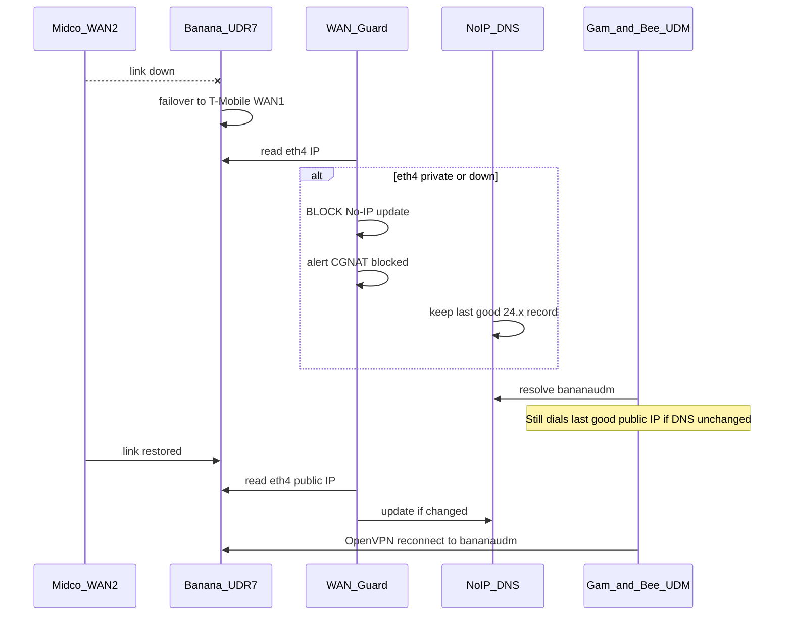

# WAN Guard — dual-WAN failover with OpenVPN site-to-site

Protect **`bananaudm.onthewifi.com`** on the Banana UDR7 when **Midco (WAN2)** fails over to **T-Mobile (WAN1)**. Without this guard, DDNS can publish a **192.168.12.x** CGNAT address; Gam-and-Bee’s **`Home-OpenVPN`** then dials an unroutable target and the tunnel drops or flaps.

Companion install: [`Public/unifi/wan-guard/`](../unifi/wan-guard/). OpenVPN setup: [`openvpn-site-to-site-migration.md`](openvpn-site-to-site-migration.md).

---

## Topology reminder

| Site | Role | WAN | Address | VPN to remote |
|------|------|-----|---------|----------------|
| Banana (UDR7) | Hub | WAN1 | T-Mobile CGNAT `192.168.12.x` | **Backup only** — must not be published in DDNS |
| Banana (UDR7) | Hub | WAN2 | Midco public `24.111.98.118` | **Primary** — OpenVPN listens here; DDNS must match |
| Gam-and-Bee (UDM) | Spoke | WAN1 | `10.0.0.42` behind XB7 | Initiates to **`bananaudm.onthewifi.com:1194`** |

Remote tunnel config (Gam-and-Bee):

- **Name:** `Home-OpenVPN`
- **Remote hostname:** `bananaudm.onthewifi.com` (not a raw IP — allows recovery after Midco returns)
- **Remote networks:** `192.168.1.0/24`

---

## What broke under IPsec (and still breaks OpenVPN the same way)

When Midco went down, UniFi failed over to T-Mobile. One or more of these happened:

1. **UniFi DDNS** (or another updater) wrote **`192.168.12.104`** (or similar) to **`bananaudm.onthewifi.com`**.
2. Gam-and-Bee resolved that **private** address and tried to build a tunnel to an **unreachable** endpoint.
3. OpenVPN on Banana may also pick **`ROUTE_GATEWAY … via 192.168.12.1 dev eth3`** during bring-up if default route prefers WAN1 — asymmetric routing and **`Inactivity timeout (--ping-restart)`** in logs.

OpenVPN does **not** fix bad DDNS. It still depends on **`bananaudm.onthewifi.com` → Midco public IP**.

**WAN Guard’s job:** never push a private/CGNAT IP to No-IP; preserve the last good public record during outage; alert you; auto-heal when Midco returns.

---

## What WAN Guard does (every 5 minutes)

On the UDR7 (`/data/wan-guard/wan-guard.sh`):

1. Read IP from **`WAN_GUARD_INTERFACE`** (default **`eth4`** = Midco WAN2).
2. If IP is **RFC1918 / CGNAT / reserved** → **block** No-IP update, email once per bad IP, set state **`cgnat_blocked`**.
3. If IP is **public** → compare to DNS for **`bananaudm.onthewifi.com`**.
4. Update No-IP only when public IP **changed**; email on recovery from stale CGNAT in DNS.

State file: **`/data/wan-guard/wan-guard.state`** (keys: `wan_ip`, `noip_ip`, `last_check_status`, `last_good_ip`).

---

## Install on Banana UDR7

From your Mac (or on-gateway):

```bash
scp -r Public/unifi/wan-guard/ root@192.168.1.1:/root/wan-guard-src
ssh root@192.168.1.1
cd /root/wan-guard-src
bash install.sh
```

Then edit shared config (appended to **`/data/tunnel-monitor/config.env`** if tunnel-monitor is already installed):

```bash
nano /data/tunnel-monitor/config.env
```

Required keys (see [`config-additions.env`](../unifi/wan-guard/config-additions.env)):

| Variable | Example | Purpose |
|----------|---------|---------|
| `WAN_GUARD_INTERFACE` | `eth4` | Midco WAN2 only — verify with `ip -4 addr show eth4` |
| `WAN_GUARD_HOSTNAME` | `bananaudm.onthewifi.com` | Hostname Gam-and-Bee dials |
| `WAN_GUARD_NOIP_USER` | `roto31` | No-IP account |
| `WAN_GUARD_NOIP_PASS` | *(secret)* | No-IP password — never commit |
| `ALERT_EMAIL`, `SMTP_*` | *(from tunnel-monitor)* | Alert delivery |

Verify interface after firmware updates:

```bash
ip -4 addr | grep -E 'inet .* eth'
# Midco public should appear on eth4 (adjust WAN_GUARD_INTERFACE if not)
```

Smoke test:

```bash
wan-guard test-email
wan-guard check
wan-guard status
bash /root/wan-guard-src/test-wan-guard.sh   # optional unit tests
```

---

## UniFi settings — keep OpenVPN stable during failover

Do these **once** on Banana; they complement WAN Guard (DNS) with routing behaviour.

### 1. Disable UniFi DDNS on the T-Mobile WAN

**Settings → Internet → WAN1 (T-Mobile)** → turn **off** Dynamic DNS / No-IP for that interface.

Only **`bananaudm.onthewifi.com`** should be updated — and **only** from WAN Guard reading **WAN2**, not from UniFi auto-update on WAN1.

### 2. Failover policy — do not prefer T-Mobile for VPN traffic

**Settings → Internet → WAN** (Failover / Load balancing):

- **Preferred / primary WAN for general traffic:** your choice.
- **Critical:** when Midco is **up**, ensure VPN/OpenVPN egress uses **WAN2** (Midco). After a Midco outage, when WAN2 returns, confirm OpenVPN reconnects on **`24.x`**, not **`192.168.12.x`**.

If OpenVPN logs show **`ROUTE_GATEWAY … eth3`** (T-Mobile) while Midco is up, adjust failover weights so **WAN2 is default** for new sessions, or add a **static route** on Banana:

- Destination: **`75.73.219.205/32`** (Gam-and-Bee Comcast public)
- Interface: **WAN2 / Midco**

(Exact UI labels vary by Network app version.)

### 3. OpenVPN tunnel values (unchanged by failover doc)

| Side | Tunnel name | Remote hostname | Port |
|------|-------------|-----------------|------|
| Banana | `Gam-and-Bee-OpenVPN` | `gamandbeeu.onthewifi.com` | UDP 1194 |
| Gam-and-Bee | `Home-OpenVPN` | `bananaudm.onthewifi.com` | UDP 1194 |

Do **not** point **`Home-OpenVPN`** at a static IP unless you accept manual updates when Midco changes.

### 4. AppleTV policy

**Gam-and-Bee → Policy Engine → `AppleTV-Tunnel` → Interface:** **`Home-OpenVPN`** (not legacy IPsec **`Home-Tunnel`**).

---

## Timeline when Midco fails



**Expected behaviour with WAN Guard installed:**

| Phase | DDNS | OpenVPN | AppleTV VLAN |
|-------|------|---------|--------------|
| Midco up | `bananaudm` = `24.x` | Connected | Routes via tunnel |
| Midco down, T-Mobile active | **Unchanged** (guard blocks bad push) | May drop until Midco back; DNS still valid | Kill switch — no Comcast leak |
| Midco restored | Auto-update if IP changed | Reconnect within ~1–5 min | Resumes |

**Without WAN Guard:** DDNS may flip to **`192.168.12.x`** → tunnel broken until manual No-IP fix even after Midco returns.

---

## Operator runbook

### Midco outage (alert: “CGNAT IP on Midco WAN2 — DDNS blocked”)

1. **Do not** manually set No-IP to T-Mobile’s address.
2. Confirm **`wan-guard status`** shows **`cgnat_blocked`** and **`noip_ip`** still shows last public IP.
3. **`dig +short bananaudm.onthewifi.com`** — should **not** be `192.168.12.x`.
4. Expect **`Home-OpenVPN`** offline until Midco returns — AppleTV kill switch is intentional.
5. Mac Studio: **`tunnel-check`** will show tunnel **DOWN**; dedup may still reach UDR7 via LAN.

### Midco restored (alert: “DDNS updated” or “CGNAT RECOVERY”)

1. **`wan-guard status`** → **`in_sync`** or **`updated`**.
2. **`dig +short bananaudm.onthewifi.com`** → current Midco public.
3. UniFi both sites: **`Gam-and-Bee-OpenVPN`** / **`Home-OpenVPN`** → **Connected**.
4. **`ping 192.168.0.1`** from Mac Studio; **`sudo tunnel-check --check-now`**.

### OpenVPN up but UI “Offline” / ping-restart in logs

1. Check **`journalctl -t openvpn -n 50`** on Banana for **`Inactivity timeout`** vs **`Initialization Sequence Completed`**.
2. Confirm **`ROUTE_GATEWAY`** is not stuck on **`eth3`** after Midco is back.
3. Toggle tunnel off/on in UniFi or **`service openvpn reload`** on Banana (last resort).

### After UDR7 firmware update

Re-run if needed:

```bash
cd /root/wan-guard-src && bash install.sh
wan-guard status   # verify eth4 still Midco
systemctl status wan-guard.timer
```

---

## Integration with tunnel-monitor

| Component | Location | Role |
|-----------|----------|------|
| Mac monitor | `/opt/tunnel-monitor/` | Pings **`192.168.0.1`**, emails from Studio |
| UDR7 monitor | `/data/tunnel-monitor/` | Pings remote LAN, dedup state **`N:UP`** |
| WAN Guard | `/data/wan-guard/` | Protects **`bananaudm`** DDNS only |

WAN Guard does **not** restart OpenVPN. Correct DDNS + UniFi failover policy lets OpenVPN reconnect on its own.

Optional correlation: compare **`/data/wan-guard/wan-guard.state`** `last_check_status` with tunnel-monitor logs during outages.

---

## Testing (safe)

Dry run (no No-IP writes):

```bash
# On UDR7, temporarily in config.env:
WAN_GUARD_DRY_RUN="true"
wan-guard check
```

Run packaged tests on a workstation:

```bash
bash Public/unifi/wan-guard/test-wan-guard.sh
```

Simulate CGNAT block logic: tests assert **`192.168.12.104`** triggers block and **`24.111.98.118`** sync path works.

---

## Rollback

```bash
systemctl disable --now wan-guard.timer
rm -f /etc/systemd/system/wan-guard.{service,timer}
systemctl daemon-reload
```

Remove **`WAN_GUARD_*`** keys from **`/data/tunnel-monitor/config.env`** if desired. Re-enable UniFi DDNS only if you accept the CGNAT risk.

---

## References

- Ubiquiti OpenVPN S2S: [Help Center](https://help.ui.com/hc/en-us/articles/12646699585047-UniFi-Gateway-OpenVPN-Site-to-Site)
- No-IP update API responses: [No-IP integrate docs](https://www.noip.com/integrate/response)
- Local OpenVPN migration: [`openvpn-site-to-site-migration.md`](openvpn-site-to-site-migration.md)
